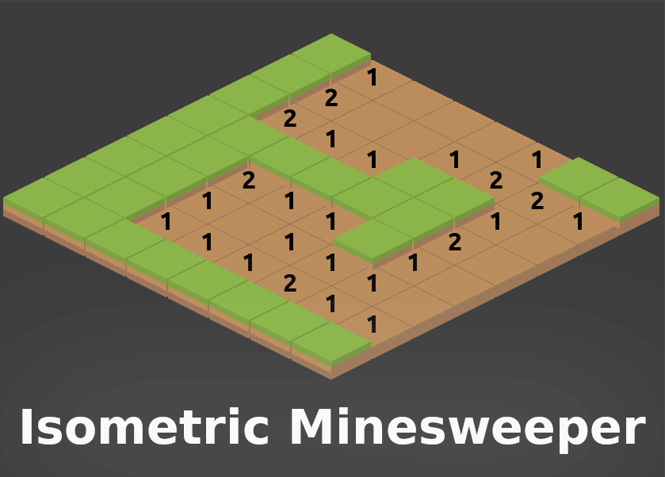
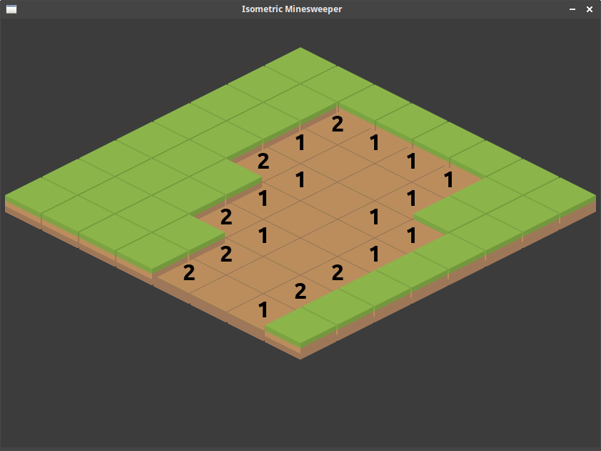
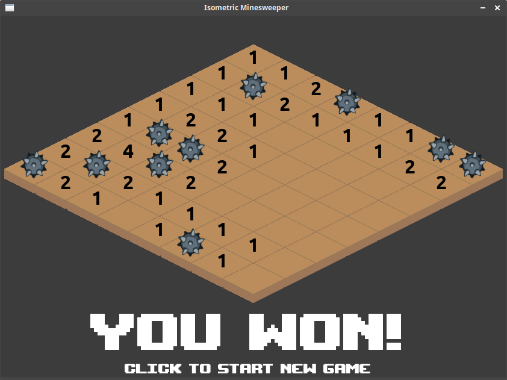
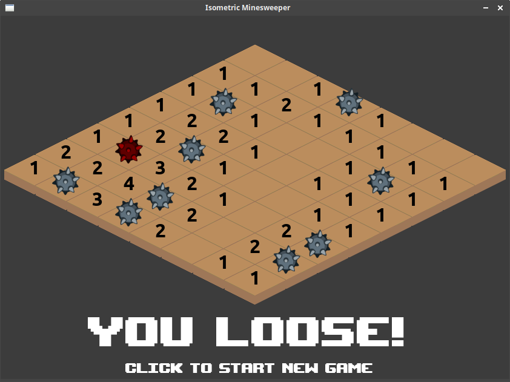
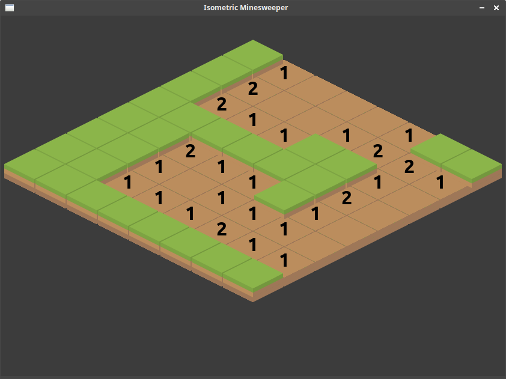

# Isometric Minesweeper
Minesweeper in isometric view, written in C++ / SDL2.



## Install Dependencies
```sh
sh install-req.sh
```

## Compile
```sh
sh compile.sh
```

## Run
./bin/isometric-minesweeeper

## Download binary

[Download](https://jakubthedeveloper.itch.io/isometric-minesweeper)

## Screenshots






